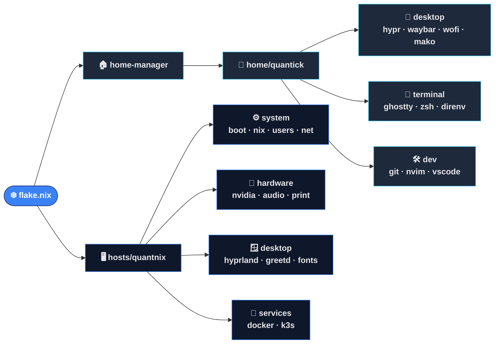

<div align="center">


<a href="#">
  
</a>

<br/>

[](https://nixos.org)
[](https://nixos.wiki/wiki/Flakes)
[](https://github.com/nix-community/home-manager)
[](https://hyprland.org)
[](https://www.nvidia.com)


<br/>

**Декларативное окружение на NixOS + Home Manager для хоста `quantnix`.**<br/>
Одна команда — и машина в точности такая, как описано в репозитории.

<br/>


<br/><br/>

[Что внутри](#-что-внутри) •
[Архитектура](#-архитектура) •
[Быстрый старт](#-быстрый-старт) •
[Горячие клавиши](#%EF%B8%8F-горячие-клавиши-hyprland) •
[Соглашения](#-соглашения)

</div>

<!--
  📸 Скриншот рабочего стола: положите файл в .github/assets/screenshot.png и раскомментируйте
<p align="center"></p>
-->

---

## ✨ Что внутри

| | Слой | Состав |
|:-:|------|--------|
| 🚀 | **Загрузка** | GRUB (UEFI), `linuxPackages_latest`, тихий boot + Plymouth (`owl`) |
| 🎮 | **Графика** | NVIDIA (проприетарный драйвер, modesetting), Hyprland + XWayland |
| 🪟 | **Сессия** | greetd + tuigreet, waybar, wofi, mako, wlogout, hyprlock, hyprpaper, hyprsunset |
| 🔊 | **Звук / печать** | PipeWire + WirePlumber, CUPS + Avahi |
| 👻 | **Терминал** | Ghostty, zsh (oh-my-zsh + Powerlevel10k), direnv + nix-direnv |
| 🛠️ | **Разработка** | Neovim (kickstart.nvim), VS Code, Zed, IDEA, Go, Python (uv), Node, Rust, JDK 21 |
| 🐳 | **Сервисы** | Docker 25, k3s (одноузловой, kubectl без sudo) |
| ❄️ | **Nix** | flakes, `nh` с еженедельной очисткой (`--keep 3`), nix-ld, unfree |

### 📦 Flake inputs

| Input | Назначение |
|-------|-----------|
| [`nixpkgs`](https://github.com/NixOS/nixpkgs) | `nixos-unstable` — rolling release |
| [`home-manager`](https://github.com/nix-community/home-manager) | подключён как модуль NixOS |
| [`nix-vscode-extensions`](https://github.com/nix-community/nix-vscode-extensions) | оверлей `pkgs.vscode-marketplace.*` |
| [`llm-agents`](https://github.com/numtide/llm-agents.nix) | оверлей `pkgs.llm-agents.*` (opencode и др.) |
| [`codex-desktop-linux`](https://github.com/ilysenko/codex-desktop-linux) | HM-модуль Codex Desktop |

---

## 🧬 Архитектура



<details>
<summary><b>📁 Дерево файлов</b></summary>

```
flake.nix                  # inputs, сборка хоста + Home Manager
hosts/quantnix/            # система
├── default.nix            # точка входа, timezone, stateVersion
├── hardware-configuration.nix
├── system/                # boot, nix, users (+sudo), networking
├── hardware/              # nvidia, audio, print
├── desktop/               # hyprland, greetd, fonts
├── services/              # docker, k3s
└── packages.nix           # системные пакеты
home/quantick/             # пользователь (Home Manager)
├── default.nix            # точка входа, xdg mimeApps
├── desktop/               # hypr/, waybar/, wofi/, mako/, wlogout/, flameshot.nix
├── terminal/              # ghostty, zsh, direnv
├── dev/                   # git, nvim/, vscode
└── packages.nix           # пользовательские приложения
```

Конфиги в родных форматах (`.conf`, `.jsonc`, `.css`) лежат рядом со своими модулями.

</details>

---

## 🚀 Быстрый старт

```sh
# применить систему + Home Manager
sudo nixos-rebuild switch --flake .#quantnix

# собрать и активировать без добавления в загрузчик
sudo nixos-rebuild test --flake .#quantnix

# только собрать
nix build .#nixosConfigurations.quantnix.config.system.build.toplevel

# обновить inputs
nix flake update
```

| Алиас | Команда |
|:-----:|---------|
| `nr` | rebuild switch |
| `nu` | flake update |
| `ngc` | сборка мусора |
| `hr` | `hyprctl reload` |
| `hb` | `hyprctl binds` |

> [!IMPORTANT]
> Flake видит только файлы, отслеживаемые git: новые файлы нужно `git add` перед сборкой.

<details>
<summary><b>💿 Установка на новую машину</b></summary>

1. Установить NixOS, склонировать репозиторий в `~/envix`.
2. Заменить `hosts/quantnix/hardware-configuration.nix` на сгенерированный `nixos-generate-config`.
3. Поправить под себя: пользователя (`system/users.nix`, `home/quantick/`), монитор в `hyprland.conf`, git-идентичность в `dev/git.nix`.
4. `sudo nixos-rebuild switch --flake .#quantnix`.

</details>

---

## ⌨️ Горячие клавиши Hyprland

<table>
<tr><td valign="top">

| Клавиши | Действие |
|---------|----------|
| <kbd>Super</kbd> + <kbd>Enter</kbd> | Ghostty |
| <kbd>Super</kbd> + <kbd>A</kbd> | wofi (лаунчер) |
| <kbd>Print</kbd> | flameshot (область) |
| <kbd>Super</kbd> + <kbd>Q</kbd> | закрыть окно |
| <kbd>Super</kbd> + <kbd>F</kbd> | максимизировать |
| <kbd>Super</kbd> + <kbd>H</kbd><kbd>J</kbd><kbd>K</kbd><kbd>L</kbd> | фокус ← ↓ ↑ → |

</td><td valign="top">

| Клавиши | Действие |
|---------|----------|
| <kbd>Super</kbd> + <kbd>1</kbd>…<kbd>0</kbd> | рабочий стол 1–10 |
| <kbd>Super</kbd> + <kbd>Shift</kbd> + <kbd>1</kbd>…<kbd>0</kbd> | перенести окно |
| <kbd>Super</kbd> + <kbd>ЛКМ</kbd> / <kbd>ПКМ</kbd> | двигать / ресайзить |
| <kbd>Super</kbd> + <kbd>Shift</kbd> + <kbd>L</kbd> | hyprlock |
| <kbd>Super</kbd> + <kbd>Shift</kbd> + <kbd>Q</kbd> | выйти из Hyprland |
| <kbd>Ctrl</kbd> + <kbd>Alt</kbd> + <kbd>Del</kbd> | wlogout |

</td></tr>
</table>

Полный список: `hyprctl binds` (алиас `hb`).

---

## 📐 Соглашения

- 📍 Каждый пакет объявлен ровно в одном месте; пакеты подсистемы — в её модуле.
- 🎯 Форматирование: `nixpkgs-fmt`, отступ 2 пробела.
- 🔐 Секреты в репозиторий не коммитятся.

> [!WARNING]
> Файрвол отключён (`system/networking.nix`) — включить, если машина в недоверенной сети.

<div align="center">

<br/>

<sub>Built with ❄️ Nix and a lot of ☕</sub>


</div>
